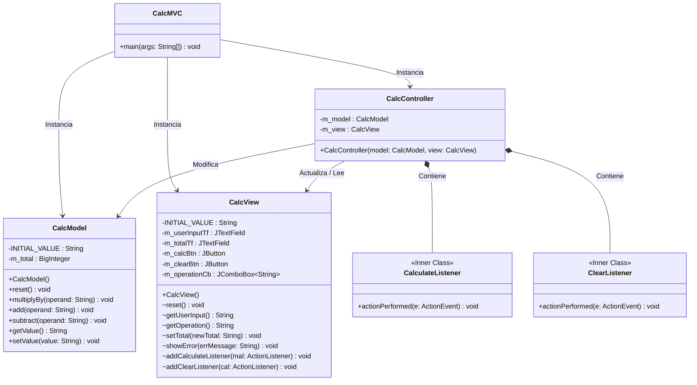

# Diagrama de Clases - Calculadora MVC

Este diagrama representa la estructura de la calculadora utilizando el patrón de diseño Modelo-Vista-Controlador (MVC) sin la implementación del patrón Command, basándose en un bloque de control de flujo para la selección de las operaciones.

