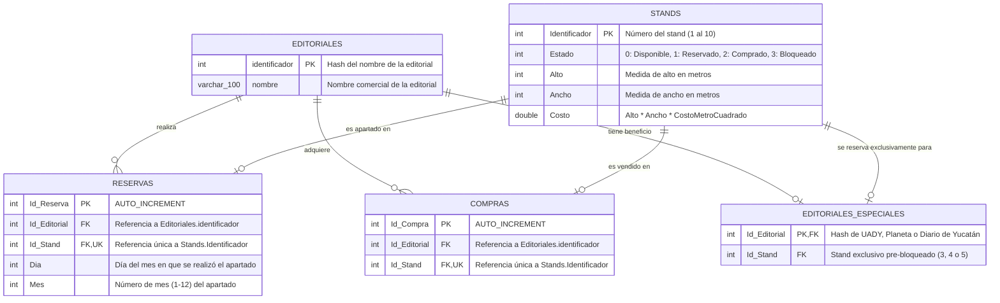

# Diagrama Entidad-Relación (ER) - Base de Datos FILEY

## Leyenda de Notación y Restricciones

### Restricciones de Columna
* **`PK` (Primary Key):** Llave primaria que identifica de manera única cada registro de la tabla.
* **`FK` (Foreign Key):** Llave foránea lógica que referencia a la llave primaria de otra tabla (`Editoriales` o `Stands`).
* **`UK` (Unique Key):** Restricción `UNIQUE` que impide que un mismo stand sea reservado o comprado más de una vez simultáneamente.

### Cardinalidades Utilizadas
* **`||--o{` (Uno a Muchos):** Una editorial puede realizar cero o múltiples reservas o compras.
* **`||--o|` (Uno a Cero o Uno):** Un stand puede estar asociado a lo sumo a una reserva activa, a una compra definitiva o a una asignación especial debido a su restricción `UNIQUE` / `PRIMARY KEY`.

---

## Diagrama Entidad-Relación (MySQL - Clever Cloud)

---

## Descripción de las Tablas y Relaciones

1. **`Editoriales` $\leftrightarrow$ `Reservas` y `Compras` (`1:N`):** Una misma editorial puede apartar o adquirir varios stands distintos durante la feria, registrando su `identificador` en las columnas `Id_Editorial`.
2. **`Stands` $\leftrightarrow$ `Reservas` y `Compras` (`1:0..1`):** Gracias a la restricción `UNIQUE` en `Id_Stand`, cada stand físico del croquis solo puede aparecer una vez en `Reservas` o una vez en `Compras`, evitando duplicidades o conflictos de asignación.
3. **`EditorialesEspeciales`:** Actúa como tabla de configuración de privilegios previos al evento, vinculando directamente el identificador de tres editoriales invitadas (`UADY`, `Planeta` y `Diario de Yucatán`) con su stand reservado (`5`, `3` y `4` respectivamente) para desbloquearlo automáticamente al iniciar sesión.