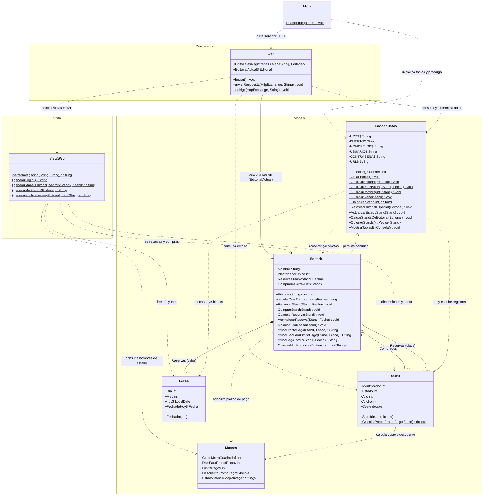

# Diagrama de Clases UML - Sistema de Gestión de Stands (FILEY)

## Leyenda de Relaciones y Notación UML

### Tipos de Relaciones
* **Asociación (`-->`):** Representa una referencia directa y persistente en memoria hacia otro objeto (por ejemplo, el controlador `Web` mantiene la sesión activa `EditorialActual`).
* **Agregación (`o--`):** Indica una relación de pertenencia débil ("tiene un"). `Editorial` agrupa colecciones de `Stand` (en `Comprados` y `Reservas`), pero los stands existen independientemente en el sistema y en la base de datos.
* **Composición (`*--`):** Indica una relación de pertenencia fuerte. Los objetos `Fecha` existen vinculados directamente al ciclo de vida de cada reserva dentro de `Editorial`.
* **Dependencia (`..>`):** Señala que una clase utiliza temporalmente a otra (invocando sus métodos estáticos o recibiéndola como parámetro), sin conservarla como atributo propio (por ejemplo, `VistaWeb` leyendo datos del `Modelo`).

### Modificadores de Visibilidad y Alcance
* **`+` Público (`public`):** Accesible desde cualquier paquete del proyecto.
* **`-` Privado (`private`):** Accesible únicamente dentro de la misma clase.
* **`~` Paquete (`default`):** Accesible únicamente para clases dentro del mismo paquete (`Modelo`).
* **`$` Estático (`static`):** Pertenece directamente a la clase y no requiere instanciar un objeto para ser invocado.

---

## Diagrama de Clases (Arquitectura MVC)

